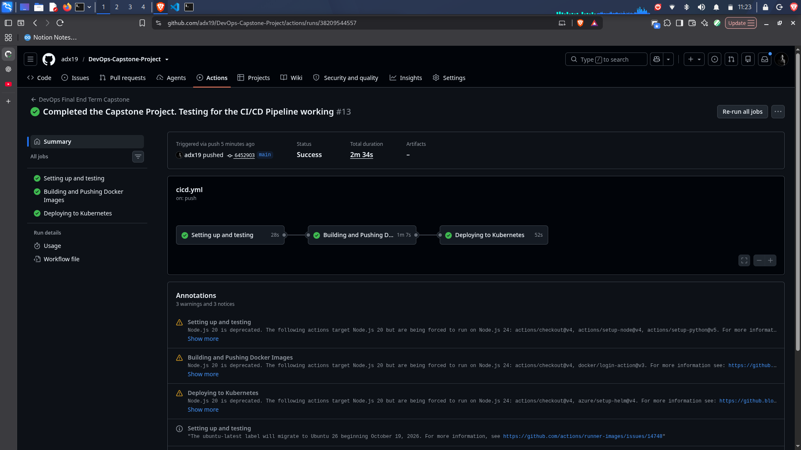
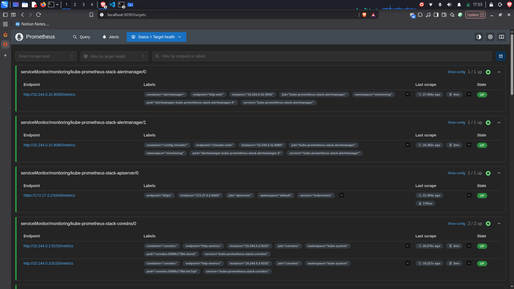
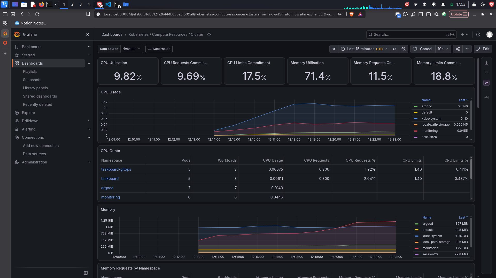

# DevOps Final End Term Capstone Project

## Student Details

- **Name:** Abhijit P
- **Roll No:** 24BCS10175
- **Batch:** A

## Overview

This project deploys TaskBoard using Docker, GitHub Actions, GHCR, Kubernetes, and Helm.

The CI/CD pipeline tests the backend, builds the frontend, builds and scans Docker images, pushes images to GHCR, and deploys TaskBoard to a temporary Kind cluster.

The local Kubernetes setup also includes ArgoCD, Prometheus, and Grafana. Terraform configuration for AWS is included, but AWS resources have not been deployed.

## Tools Used

- **GitHub Actions** — automates the CI/CD pipeline.
- **Python and pytest** — run backend tests.
- **Node.js and npm** — build the frontend.
- **Docker** — builds container images.
- **GHCR** — stores container images.
- **Trivy** — scans images for HIGH and CRITICAL vulnerabilities.
- **Kubernetes and Kind** — run containers in a Kubernetes cluster.
- **Helm** — deploys TaskBoard.
- **ArgoCD** — manages the GitOps application.
- **Prometheus** — collects application and Kubernetes metrics.
- **Grafana** — displays monitoring dashboards.
- **Terraform** — defines AWS infrastructure as code.

## CI/CD Workflow

The workflow runs on pushes to `main` and pull requests targeting `main`.

### 1. Test

The workflow:

- Sets up Python 3.12 and installs backend dependencies.
- Runs backend tests using `pytest -q`.
- Sets up Node.js 22 and installs frontend dependencies.
- Builds the frontend using `npm run build`.

The next job runs only if the tests and frontend build succeed.

### 2. Build, Scan, and Push Docker Images

The workflow builds separate backend and frontend images using the Git commit SHA as the tag.

Trivy scans both images for HIGH and CRITICAL vulnerabilities. Unfixed vulnerabilities are ignored, and qualifying findings fail the scan.

Images are pushed to GHCR only after both scans pass.

```text
ghcr.io/<repository-owner>/taskboard-backend:<commit-sha>
ghcr.io/<repository-owner>/taskboard-frontend:<commit-sha>
```

### 3. Deploy with Helm

For pushes to `main`, the workflow:

1. Creates a temporary Kind cluster in GitHub Actions.
2. Checks the cluster.
3. Deploys TaskBoard using Helm and the commit-SHA image tags.

The deployment runs in the `taskboard` namespace.

This temporary cluster is separate from my local Kind cluster on Kali Linux.

### CI/CD Pipeline Execution



**Figure 1. GitHub Actions workflow execution.**

## Local Application UI and Task Workflow

The following screenshots show TaskBoard running locally at `localhost:1919`.

### Initial Dashboard


**Figure 2. Initial dashboard.**

### Creating a Task


**Figure 3. Task creation form.**

### Task in To Do


**Figure 4. Task in To Do.**

### Task in Progress


**Figure 5. Task in In Progress.**

### Task Completed


**Figure 6. Completed task.**

## Backend Environment Setup and Testing

These screenshots show backend setup and testing.

### Virtual Environment


**Figure 7. Backend virtual environment setup.**


**Figure 8. Installing backend dependencies.**

### Package Installation


**Figure 9. Package installation output.**

### Test Execution


**Figure 10. Backend test execution.**

## ArgoCD GitOps

ArgoCD is installed in the local Kubernetes cluster and manages the TaskBoard GitOps application.

The local ArgoCD setup is separate from the temporary GitHub Actions cluster.

## Prometheus and Grafana Monitoring

Prometheus collects metrics from the TaskBoard backend through the `/metrics` endpoint. A ServiceMonitor discovers the backend endpoints.



**Figure 11. Prometheus monitoring targets.**

Grafana displays Kubernetes resource usage and namespace metrics.



**Figure 12. Grafana monitoring dashboard.**

## Terraform and AWS

Terraform configuration is included for AWS infrastructure. AWS resources have not been deployed.

## Running the Workflow

1. Commit and push changes to `main`, or open a pull request targeting `main`.
2. Open the repository on GitHub.
3. Go to **Actions**.
4. Open the latest workflow run.
5. Check the test, build-push, and deployment jobs.

## Checking the Local Kubernetes Deployment

Run these commands with the `kind-session20` context configured.

```bash
kubectl --context kind-session20 config current-context
kubectl --context kind-session20 get nodes
helm --kube-context kind-session20 status taskboard -n taskboard
kubectl --context kind-session20 get pods -n taskboard
kubectl --context kind-session20 get deployments,services -n taskboard
```

To access the frontend, run:

```bash
kubectl --context kind-session20 port-forward -n taskboard svc/taskboard-frontend 3030:3030
```

Open [http://localhost:3030](http://localhost:3030). Stop port forwarding with `Ctrl+C`.

## Troubleshooting Notes

- **Kubernetes cluster unreachable:** Check the current context and cluster status.
- **ImagePullBackOff:** Check the image name, tag, and GHCR access.
- **Pod not Ready:** Check pod events, readiness probes, and logs.
- **Trivy scan fails:** Review the reported HIGH and CRITICAL vulnerabilities.
- **Frontend API fails:** Check browser developer tools and backend logs.

## Result

The project includes a CI/CD pipeline for testing, building, scanning, and pushing Docker images, followed by Helm deployment to a temporary Kind cluster.

The local Kubernetes setup includes TaskBoard, ArgoCD, Prometheus, and Grafana. Terraform configuration is included, but AWS resources have not been deployed.

## Screenshot Files

All screenshots are stored in the `screenshots/` directory at the project root. Relative paths are used so GitHub displays the images directly in the README preview.

## Demo:

- The presentation is in the given link: 

- To see the video click in this link: [Video Presentation](https://drive.google.com/file/d/1p57WFkRJHcVLtqjdi4A-qWMNHmzwGoih/view?usp=sharing)